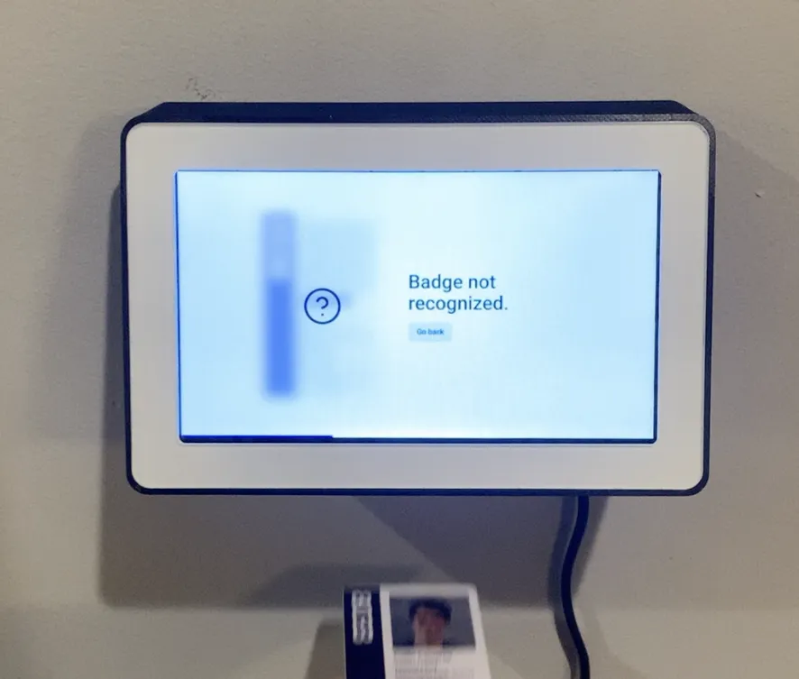
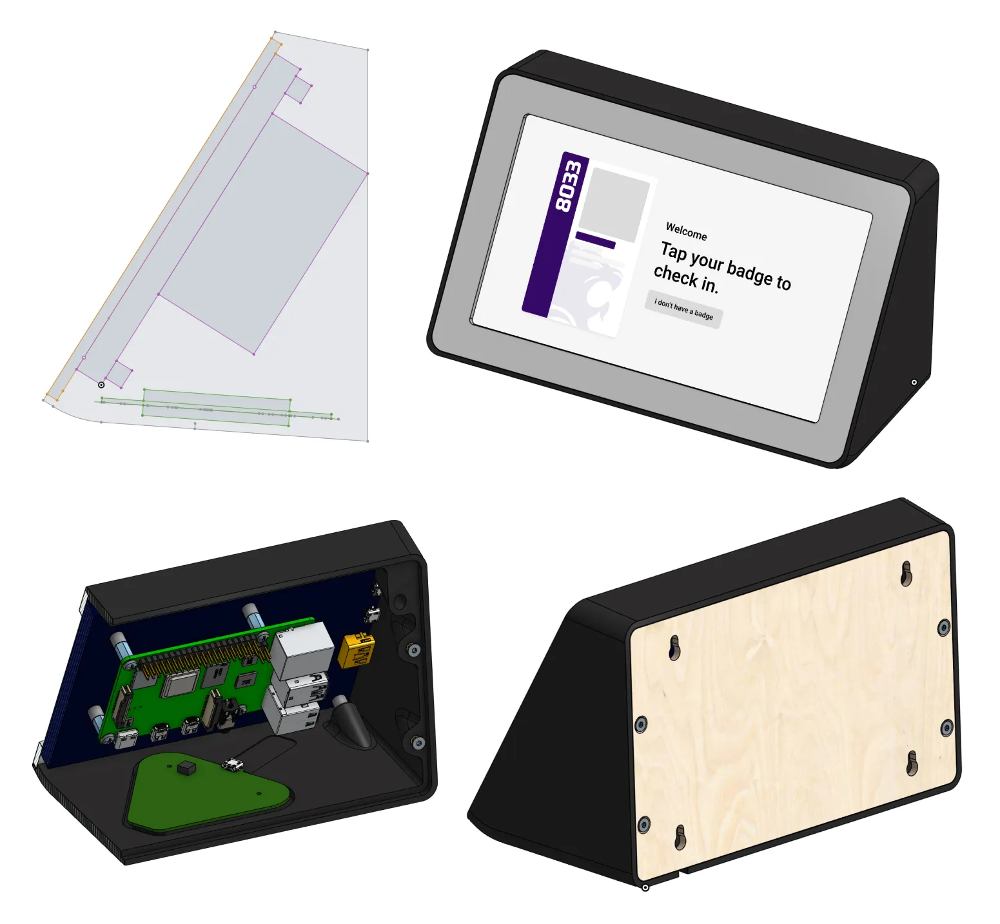
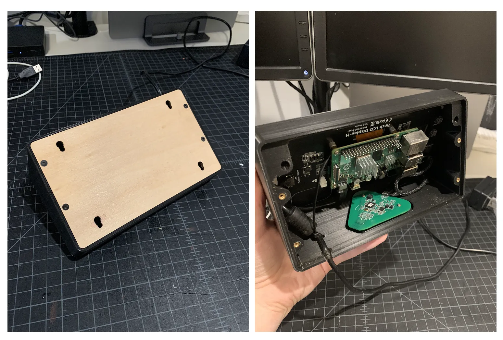
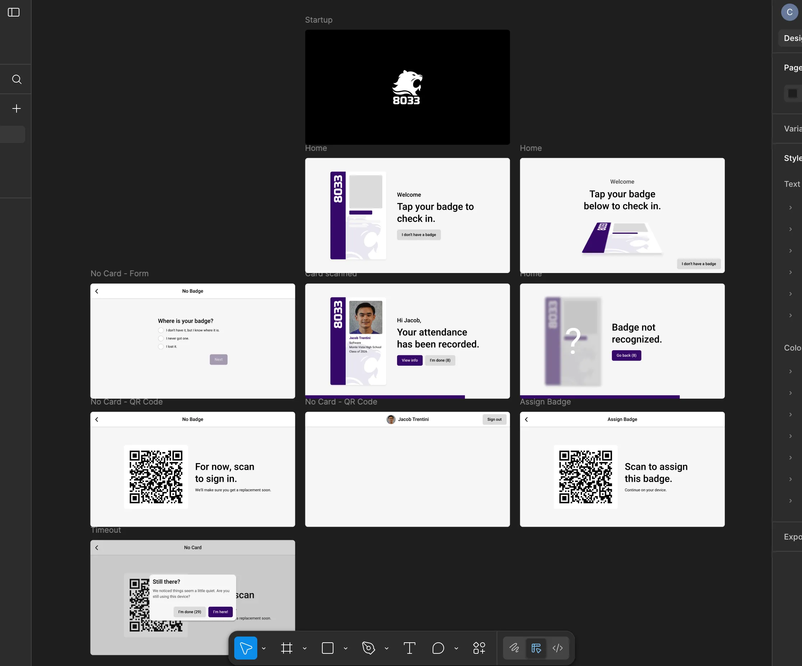

# Attendance Kiosk

A badge-in kiosk built for FRC Team 8033. Students tap an ID card or an Apple Wallet NFC pass, and the kiosk logs their attendance on the team's server. It's built to handle 50+ students arriving within about 30 minutes, so you can scan at any time without touching the screen.

<p align="center">
  
</p>

[CAD in Onshape](https://cad.onshape.com/documents/2d68ed571bc2e991534aa17d/w/a59ec1f5fa5c7dbcaf3419e4/e/03d1466513722d9342d5de94)

## Hardware

<p align="center">
  
</p>

| Component | Part |
| --- | --- |
| Computer | Raspberry Pi |
| Display | 7" touchscreen |
| Reader | ID TECH PiP (Mifare cards + Apple Wallet passes) |

I designed the enclosure in [PTC Onshape](https://cad.onshape.com/documents/2d68ed571bc2e991534aa17d/w/a59ec1f5fa5c7dbcaf3419e4/e/03d1466513722d9342d5de94). I started from top-down sketches to set the space constraints, then built them out into an enclosure with mounts for the Raspberry Pi, the display, and the reader. The body is 3d-printed. The back and face plates are laser cut wood and acrylic. I spray painted the back of the acrylic on the face plate, so the paint is layered behind the acrylic's smooth, glossy surface.

<p align="center">
  
</p>

## UI

I designed the UI in Figma with the goal that a student should never have to wait to scan. I implemented smooth, interruptible animations that hide loading states, and extra text only shows up when the server is unusually slow. If a student doesn't have a badge with them, a flow lets them scan a QR code instead.

<p align="center">
  
</p>

## Software

This is a pnpm workspace with two packages:

- **`packages/scanner`:** a small Node server ([Hono](https://hono.dev)) that talks to the reader over USB HID and pushes scans to the app through a WebSocket (`ws://localhost:3000/ws`). The ID TECH protocol is implemented by hand in [`src/pip.ts`](packages/scanner/src/pip.ts): HID report framing, CRC-16 checks and TLV parsing. I wrote it myself because the existing libraries were outdated or overcomplicated.
- **`packages/app`:** the kiosk UI (React, Vite, TanStack Router/Query, Framer Motion, Tailwind). It looks up each scanned badge on the team server.

### Running it

```sh
pnpm install
```

Create `packages/app/.env`:

```sh
VITE_SERVER_URL=https://your-team-server.example
VITE_SERVER_KEY=your-api-key
```

```sh
pnpm dev   # starts the scanner (port 3000) and the app together
```

In development, you can fake a scan without a reader:

```sh
curl -X POST localhost:3000/scan -H 'Content-Type: application/json' -d '{"payload":"12345"}'
```

On Linux, the user running the scanner needs access to the reader's hidraw device (vendor `0x0acd`).
